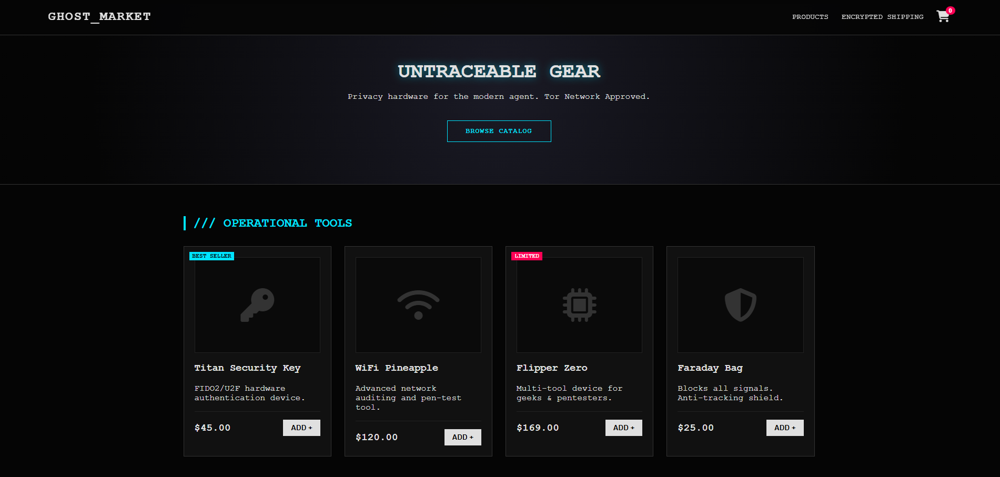

# Ghost Market UI

A front-end prototype for a fictional storefront, built with HTML, CSS, and vanilla JavaScript. The cart updates item quantities, item count, and order total as you add or remove items. The catalog uses a responsive layout, and checkout is a mock interaction.

Open `index.html` in a browser to try the prototype locally.

